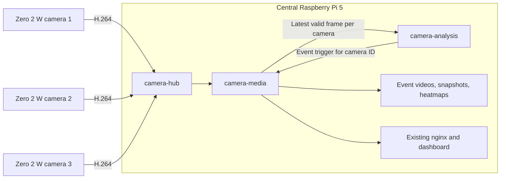

# Raspberry Pi Zero 2 W camera nodes and shared central services

Status: shared UI and two-container supervisor implemented, 2026-11-12. The optional
MediaMTX relay is implemented in `docker-compose.camera-hub.yml`; enable it with
`scripts/restart-camera-hub.sh`. It automatically relays registered RTSP cameras
over one upstream per camera and leaves the local CSI source direct. The generated
private runtime config reloads on camera additions. Enable the shared supervisor
with `scripts/restart-cameras-shared.sh`. One page supports adding/selecting cameras
and independently starting/stopping their processes. The hub is deployed for the
current Thingino camera; no physical Zero node is deployed yet. The target is two
or three remote CSI cameras on Zero 2 W nodes,
with analysis and event storage on the current Pi 5. Thingino is not a future
deployment requirement; generic RTSP input remains useful for the new nodes.

## Current readiness

| Area | Implemented | Remaining work |
| --- | --- | --- |
| Analysis | One shared process; one stable execution thread per camera; independent baselines, ROI, sessions, commands and locks | Derive the entire active camera list from configuration, including optional original cameras |
| Registration | Additional RTSP cameras, generated routing, health entries and storage directories | Existing `wifi` and `pi` entries are still special cases; no `enabled` field or remote capture-control capability in the current schema |
| User interface | Shared frontend assets with the current learning, ROI, heatmap and event workflow | One dashboard process and port per camera; module-level data paths and preview objects prevent safe sharing today |
| Recording | Per-camera H.264 stream-copy event buffer and pre/post-event assembly | One recorder service per camera; the loop uses environment defaults and main-thread signal handling |
| Sources | RTSP input or the local Pi host source | The local source explicitly uses software `libx264`; a Zero 2 W publisher must use its hardware encoder instead |

The original camera-only container count is `2N + 1`, excluding the existing nginx
and unrelated sensor services: five containers for two cameras, seven for three.
The registry does not yet merge dashboards or recorders.

The implemented shared supervisor changes that count to two. It uses independent
dashboard/recorder child processes inside one media container, preserving isolation
of the current environment-based code. The deeper single-process media/context
refactor described below remains future work; Python heaps are not shared yet.
The new private registry is `runtime/camera-manager/cameras.json`, with credential
values kept local. It supports `id`, `label`, `url`, optional local `capture_url` and
`enabled`. Its analysis list reloads additions and removals without restarting other workers.

The shared UI provides **Edit camera** and **Delete camera** for the selected camera.
Editing accepts a display name and, for remote cameras, a replacement RTSP URL.
The ID and built-in CSI source are fixed. A blank URL keeps the saved address;
credentials are never returned to the browser. Saving stops that camera so its
new settings take effect at the next start. A source address can change without
changing the scene; if the scene changes, learn a new baseline before detection.
Deletion asks for confirmation, stops that camera, removes its registry and hub
entries, and releases its analysis worker after any in-flight frame finishes.
The Add camera dialog supports RTSP sources and the built-in Pi source.
Learning and recordings remain on disk. Re-adding the same ID can reuse them,
provided the original model preprocessing settings match. Other cameras keep running.

## Proposed topology

Use two application containers on the Pi 5, optionally with one common stream hub:

| Proposed service | Responsibility | Count for 2 or 3 cameras |
| --- | --- | --- |
| `camera-media` | Shared UI/API, per-camera preview decoders, recording jobs, event buffers and retention | 1 |
| `camera-analysis` | Existing shared analysis process with independent per-camera state | 1 |
| `camera-hub` (MediaMTX) | One incoming published stream per node, distributed locally to recording and decoding | 1 if used |

The recommended remote-node target includes the hub: **three central camera
containers total**, independent of the camera count. A two-container application
deployment is also possible if nodes expose their own RTSP servers. In that case
recording and decoding can create separate network readers of the same node.
Both designs use the existing nginx rather than adding a web proxy per camera.

The hub routes compressed video; it does not run the detector or perform video
transcoding. `camera-media` initially keeps the existing FFmpeg stream-copy
recording implementation. Moving segment creation into MediaMTX is a later,
separate change: its recording format and segment lifecycle must be adapted to
the current event assembler before existing recorder jobs can be removed.

## Zero 2 W node

Run a lightweight camera publisher as a systemd service on Raspberry Pi OS Lite.
Docker and the anomaly model are unnecessary on these nodes. Capture once,
hardware-encode once, and publish one H.264 stream to a camera-specific hub path.
On the node, an `rpicam-vid` hardware-H.264 pipeline with a stream-copy publisher
is one possible implementation; native MediaMTX camera capture is an alternative
to evaluate on the actual OS/libcamera version.

Zero 2 W has 512 MB RAM, 2.4 GHz WiFi and a documented H.264 encoding capability of
1080p30. Start validation at 1280 x 720, 5 or 10 FPS, with an approximately one-second
keyframe interval. These are proposed test profiles, not measured capacity or a
promise of three-camera performance. Native 3280 x 2464 H.264 is not a target for
the first hardware-encoder deployment. Sensor readout and field of view must be
validated independently of output resolution for each camera module.

A minimal capture-control agent can later expose node status, supported modes,
exposure and capture start/stop through the central API. The current local
`pi_source.py` is not ready to copy unchanged: it assumes a Pi 5 software encoder,
a local loopback transport and a default IMX219 sensor mode. Remote settings
controls must remain unavailable until the node advertises the capability.

## Changes needed for shared media

1. Introduce an explicit per-camera context containing paths, source and capture
   settings, caches, preview objects, recorder state and cancellation events.
   Convert `dashboard.py` globals (`RECORDINGS`, `LIVE`, `BROWSER`) and the uses of
   `anomaly_control.DATA`, source caches and environment lookups to this context.
   Never switch process environment variables or module globals between requests.
2. Serve `/cameras/<id>/` and its relative API routes from one HTTP service and
   one port. Reuse the current frontend and preserve `/cameras/pi/` during migration.
3. Extract a per-camera recorder worker with explicit settings and cancellation.
   Handle process-wide signals only in the service entry point; supervise and
   restart an individual FFmpeg job without stopping the other cameras.
4. Make the registry describe all enabled cameras, rather than generating two
   containers and a port for every additional camera. `enabled`, source identity
   and optional capture-control capabilities are proposed schema additions;
   today's strict registry does not accept them yet. Keep credential values local.
5. Change Health and service-controller camera actions into per-camera media and
   analysis enable/disable commands. Stopping one camera must not stop a shared
   container. Restarting a whole service is a separate operation affecting all
   cameras. Central processing pause and remote sensor capture stop are distinct.
6. Configure the active analysis list without the unused Thingino worker. Preserve
   its saved data until removal is separately requested. Preserve current camera
   IDs, state paths and user-facing workflow while introducing the shared service.

Independent state remains under a camera ID: baseline, normal sessions, ROI,
threshold, recording buffer, events and retention counters must never be shared
between cameras. Each camera needs a bounded latest-frame slot: slow analysis
must replace stale pending frames rather than build an unbounded queue.

## Resource and failure boundaries

Fewer containers alone does not remove decoding or model execution. Putting the
same per-camera Python processes inside one container also does not share their
imported libraries. The intended savings come from actually sharing the UI/media
process, keeping the existing shared detector, and hardware-encoding at the nodes.
Per-camera decoder and stream-copy recording subprocesses can remain necessary.

Each camera still needs separate ONNX session/model state as currently implemented.
The shared analysis CPU budget must be measured under simultaneous scene changes,
when frame gating saves little work. The earlier single-camera 88 ms figure is
not a capacity guarantee. Our 2026-11-12 live 8 MP tests also showed the importance
of preview work, CPU affinity and source-to-frame age, not just inference time.

The shared media process and hub introduce common failure boundaries. Isolate
ordinary camera disconnects and FFmpeg exits per camera; document that a whole
media-process, analysis-process or hub restart can affect every camera. A source
generation change must reject stale frames/triggers and reset the temporal gate.

## Incremental implementation and acceptance

1. Refactor explicit camera contexts in the existing deployment; prove two contexts
   keep settings, learning sessions, controls and recording directories separate.
2. Add the optional shared media service and migrate the current Pi camera first.
   Verify ROI geometry, learning, snapshots, heatmaps, stream-copy event windows,
   retention, decoder recovery and Health actions before retiring old services.
3. Validate two and then three real-time simulated sources on the Pi 5. Include
   all-stream motion, concurrent event exports, camera disconnect/reconnect,
   single-camera stop/start and a slow client. Compare CPU/RAM and frame age with
   the current deployment at matched source/analysis settings.
4. Deploy the first physical Zero 2 W publisher and the common hub; verify hardware
   encoder selection, field of view, mode/exposure controls, WiFi reconnect, clock
   behavior and complete pre/post-event video. Then add nodes two and three.
5. Retire the unused Thingino deployment and the per-camera container generator
   after the shared path passes those checks. New cameras should require a
   registry entry and storage subdirectory, not a new image build or service pair.

The shared supervisor, UI, registry and per-camera controls are implemented. Node
installation, remote capture controls and shared Python media contexts remain
implementation work. Current Zero-camera preparation accepts
their RTSP feeds and preserves the same learning, ROI and event workflow.

## Primary references

- [Zero 2 W specifications](https://www.raspberrypi.com/products/raspberry-pi-zero-2-w/)
- [Raspberry Pi camera software and encoders](https://www.raspberrypi.com/documentation/accessories/camera-software.html)
- [MediaMTX publishing and reading](https://mediamtx.org/docs/features/publish-and-read)
- [MediaMTX Raspberry Pi camera support](https://github.com/bluenviron/mediamtx/blob/main/docs/4-static-sources/9-raspberry-pi-cameras.md)
- [MediaMTX recording](https://mediamtx.org/docs/features/record)
